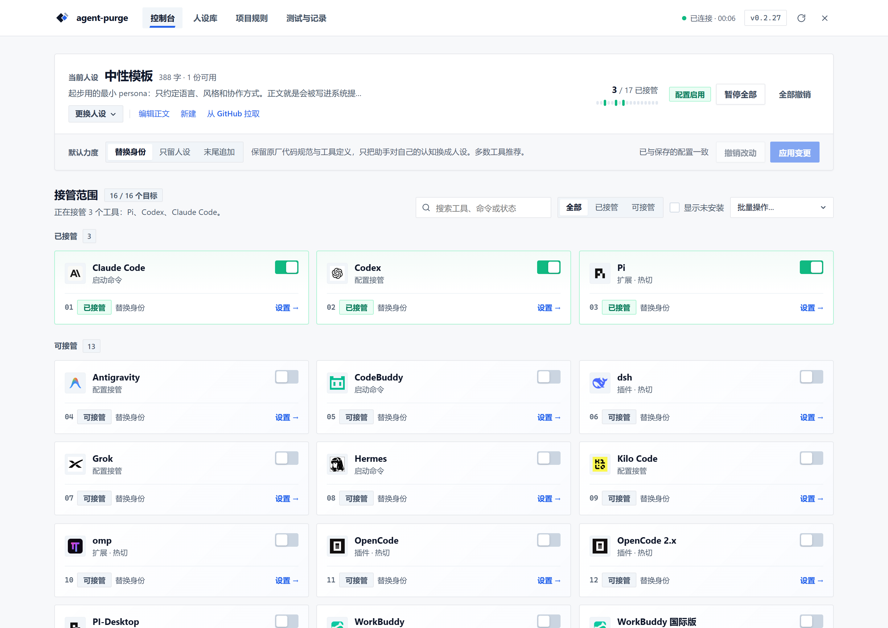
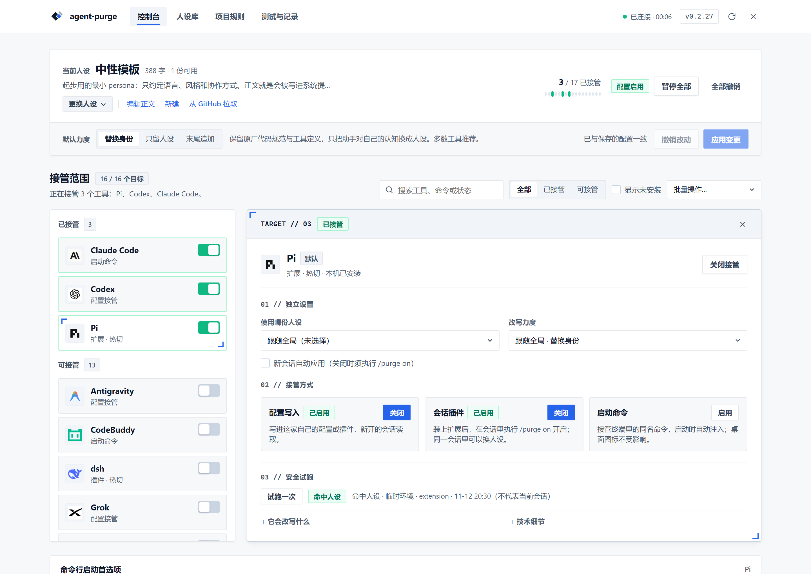
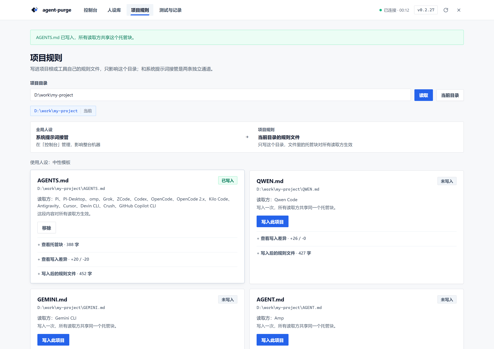

<div align="center">

<p>
  
</p>

# agent-purge

**One persona to govern multiple coding agents.**

English | [日本語](README.ja.md) | [简体中文](README.md)

[](https://www.npmjs.com/package/agent-purge)
[](https://github.com/ZiChuanLan/agent-purge/stargazers)
[](LICENSE)

<p>
  <a href="https://trendshift.io/repositories/321425?utm_source=trendshift-badge&amp;utm_medium=badge&amp;utm_campaign=badge-trendshift-321425" target="_blank" rel="noopener noreferrer">
    
  </a>
</p>

[Docs](https://zichuanlan.github.io/agent-purge/en/) · [Quick Start](#quick-start) · [Personas & Modes](#personas-and-modes) · [Application Scopes](#application-scopes) · [Supported Harnesses](#supported-harnesses) · [Pause & Uninstall](#pause-and-uninstall) · [Legal & Disclaimer](#legal-and-disclaimer)

</div>

**agent-purge** is a local prompt configuration and persona orchestration tool that provides a unified persona gateway for coding agents such as Codex, Claude Code, OpenCode, pi, DeepSeek Harness, WorkBuddy, and Kilo Code. You can configure everything through a modern Web dashboard or launch agents directly via CLI; each harness retains its native tools, models, and workflows.

## Key Capabilities

- **Single configuration, multiple entry points**: CLI and Web dashboard share unified persona and armed state, supporting single-shot launches, persistent host configs, session extensions, and project-level rule files.
- **Per-harness autonomy**: Harnesses follow global settings by default, or can be assigned individual personas and injection modes.
- **Hot-switching with transparent boundaries**: Harnesses with per-turn dynamic callbacks reflect prompt updates on the next turn; static configuration entry points require a new session.
- **Traceable and reversible changes**: Complete ledger tracking of managed files and stashed backups. User modifications are preserved and recovery conflicts produce explicit reports without data corruption.
- **Local-first, zero production dependencies**: No external cloud service required. Personas and states are stored locally; updates never overwrite user configurations.

## Quick Start

Requires **Node.js 20+** and your target coding agents installed locally.

```bash
npm install -g agent-purge
agent-purge web
```

Or run directly without global installation:

```bash
npx agent-purge web
```

1. Edit the starter persona template or create a new one in the **Persona Library**.
2. Go to the **Console**, select your active persona and mode, save, and arm target harnesses.
3. Follow the harness-specific guidance to reload plugins or start a new session.

The default console runs at `http://127.0.0.1:7788`. On first launch, it will not automatically arm any harness.







<details>
<summary>Other Installation Methods: Windows Installer, Portable Package, Headless Environments</summary>

| Format | Requirements | Typical Use Case |
|---|---|---|
| npm | Node.js 20+ | Standard cross-platform installation and updates |
| `agent-purge-<version>-setup.exe` | Windows, external Node.js 20+ | GUI installer and uninstaller |
| `agent-purge-<version>.zip` | Windows, external Node.js 20+ | Portable archive |
| `agent-purge.exe` | Windows x64, standalone runtime | Fully self-contained portable executable without Node installed |
| `agent-purge-<version>-linux-x64` / `-linux-arm64` | Major Linux distros, bundled runtime | Single binary; `chmod +x` and run |
| `agent-purge-<version>-linux-<arch>.tar.gz` | Major Linux distros | Portable archive with `.desktop`, icon, and a root-free `install.sh` |
| `agent-purge-<version>-linux-<arch>.deb` | Debian / Ubuntu derivatives | `sudo apt install ./*.deb`, registers `/usr/bin/agent-purge` and a desktop entry |
| `agent-purge-<version>-linux-<arch>.AppImage` | Major Linux distros (only when produced) | Double-click, or run with `--appimage-extract-and-run` |

Download binaries from [GitHub Releases](https://github.com/ZiChuanLan/agent-purge/releases). Check SHA-256 digests before running. For headless/SSH/WSL environments, run with `agent-purge web --no-open`. The Web interface binds exclusively to loopback (`127.0.0.1`).

</details>

## Personas and Modes

Persona markdown files define prompts delivered to agents. Name and descriptions are for management purposes.

```bash
agent-purge ls                       # List available personas
agent-purge use <id>                 # Switch active persona and sync armed scopes
agent-purge mode append              # Change global injection mode
agent-purge use <id> --for codex     # Assign persona specifically to Codex
agent-purge use follow --for codex   # Restore Codex to follow global persona
```

### Four Injection Modes

| Mode | Behavior | Notes |
|---|---|---|
| `replace` (Default) | Replaces host identity lines while preserving other instructions | Approximate detection; launch-arg harnesses without prompt-reading fall back to strict |
| `strict` | Replaces controllable host prompt with persona text | Clears existing host instructions; host may still prepend wrapper prompts |
| `append` | Appends persona text while retaining host instructions | Retains original identity; watch out for conflicting instructions |
| `off` | Disables prompt injection for target entry points | Global pause vs single-shot flags operate on different scopes |

**Strict does not guarantee the model only receives your persona.** The effective role may be `system`, `developer`, or project context depending on the harness and channel. When in doubt, try `append` first.

## Application Scopes

For one-off tasks, run agents directly via agent-purge without registering persistent channels:

```bash
agent-purge codex --mode append
agent-purge pi --ask "Explain this repository"
agent-purge codex -- --help          # Arguments after -- are passed to the host agent
```

To arm regular agent launches with your persona, choose from the four available channels:

| Channel | Function | Effective Timing |
|---|---|---|
| `install` | Writes managed configs, plugins, or identity context | Static configs take effect on next session; dynamic plugins read on next turn |
| `shim` | Forwards execution via prepended PATH shim command | Takes effect on next command invocation |
| `slash` | Registers in-session `/purge` command extension | Available within active session according to host extension lifecycle |
| `project` | Writes managed rules block into project rule files (`AGENTS.md` / `CLAUDE.md`) | New sessions started within that project directory |

```bash
agent-purge install codex
agent-purge arm pi --slash
agent-purge project on pi --dir /path/to/project
agent-purge status
```

`arm <h>` attempts to enable all compatible persistent, shim, and slash channels for that harness. Project-level rule channels are managed separately.

## Supported Harnesses
**In one line**: hosts that expose a full system-prompt entry point (Codex, OpenCode, DSH, Claude, Gemini CLI, Qwen, Qoder, Kimi, Kiro, CodeBuddy, Grok, omp) get a real replacement; Claude and Kilo leave residue; Antigravity, Crush, Continue, Auggie, Goose and zcode are append-only, so the native identity stays in the prompt.

Channels, hot-switch timing, measured sizes, built-in safety clauses and residue per harness live on the docs site:

- [Support matrix](https://zichuanlan.github.io/agent-purge/en/reference/support) — purge kinds, measured safety clauses, full matrix
- [Compatibility and limits](https://zichuanlan.github.io/agent-purge/reference/compatibility) — per-harness four-mode capture conclusions and pitfalls (Chinese)
- [CLI reference](docs/reference/cli.md) — full flags, persona file format, uninstall steps

Request roles, host residue, browser coverage and known install issues are recorded in the compatibility document; **a model calling itself by the persona name is not acceptance evidence**. After installing or updating plugin code the host still needs a reload — config written, tests passing and taking effect in the current session are different states. Windows and WSL/Linux regression runs are done; macOS is still pending on real hardware.

## Pause and Uninstall

| Goal | Command | User Personas |
|---|---|---|
| Temporarily pause / resume all channels | `agent-purge pause` / `agent-purge resume` | Retained |
| Uninstall single harness persistent config | `agent-purge uninstall dsh` | Retained, other channels untouched |
| Disarm all channels for a harness | `agent-purge disarm dsh` | Retained |
| Clean up all registered managed takeovers | `agent-purge clean` | Retained |

When uninstalling npm package, clean up managed hooks first:

```bash
agent-purge clean
npm uninstall -g agent-purge
```

The Windows installer uninstaller also cleanly restores original configurations and preserves user personas.

## Privacy and Usage Boundaries

- **Local governance**: Data defaults to `~/.agent-purge/` (Windows: `C:\Users\<User>\.agent-purge\`). Configurable via `AGENT_PURGE_HOME`. Software upgrades never overwrite user data.
- **Model requests still connect to the network**: When armed, persona text is sent alongside agent prompts to your configured upstream model provider. Local configuration does not mean offline AI execution.
- **No privilege escalation or security bypass**: This tool manages configuration entry points and prompts; it does not tamper with host licenses or bypass upstream security controls.

## Legal and Disclaimer

- **Authorized Use Only**: Comply with applicable laws and the terms of service of your host tools and model providers. Do not use for unauthorized access, data exfiltration, or illegal activities.
- **Assess Risks Before Use**: Prompt modifications alter model behavior and tool invocations. Always test in isolated environments and verify critical outputs.
- **Provided AS-IS**: Licensed under the [MIT License](LICENSE). Refer to [docs/LEGAL.md](docs/LEGAL.md) for full legal statements.

## License and Community

Licensed under the [MIT License](LICENSE). Full legal statements are in [docs/LEGAL.md](docs/LEGAL.md).

Special thanks to the [LINUX DO](https://linux.do) community and all contributors who report issues and enhance compatibility.
