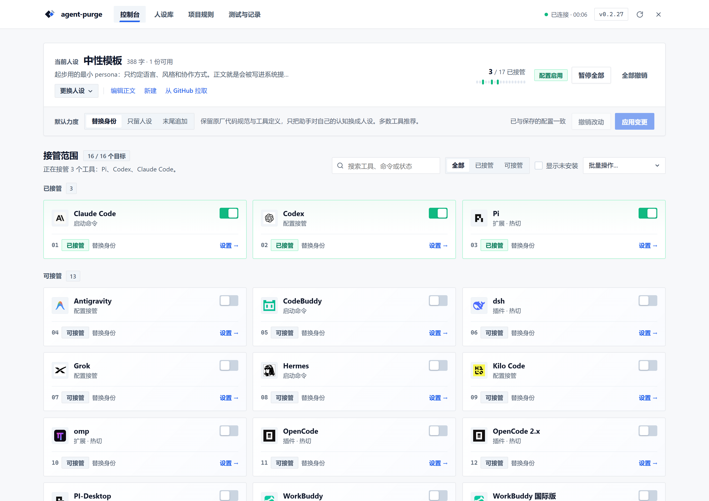
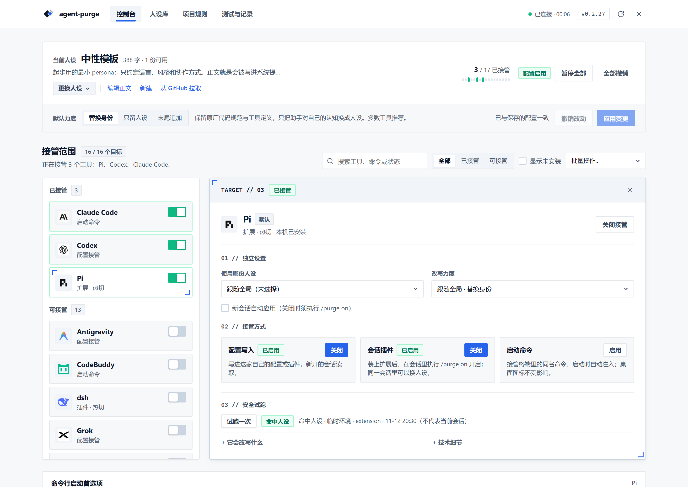
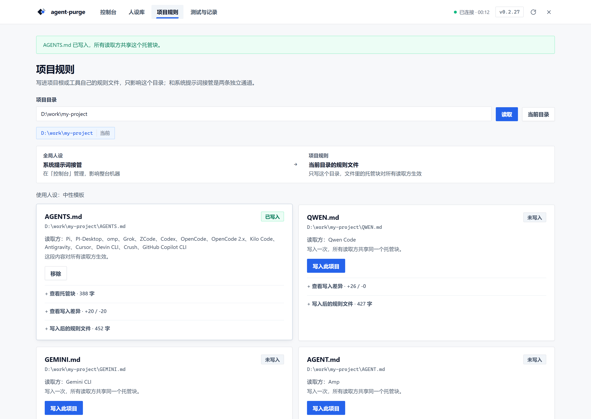

<div align="center">

<p>
  
</p>

# agent-purge

**1つのペルソナで、複数のコーディングエージェントを一元管理。**

[English](README.en.md) | 日本語 | [简体中文](README.md)

[](https://www.npmjs.com/package/agent-purge)
[](https://github.com/ZiChuanLan/agent-purge/stargazers)
[](LICENSE)

<p>
  <a href="https://trendshift.io/repositories/321425?utm_source=trendshift-badge&amp;utm_medium=badge&amp;utm_campaign=badge-trendshift-321425" target="_blank" rel="noopener noreferrer">
    
  </a>
</p>

[ドキュメント](https://zichuanlan.github.io/agent-purge/ja/) · [クイックスタート](#クイックスタート) · [ペルソナとモード](#ペルソナとモード) · [適用スコープ](#適用スコープ) · [対応エージェント](#対応エージェント) · [一時停止とアンインストール](#一時停止とアンインストール) · [免責事項とコンプライアンス](#免責事項とコンプライアンス)

</div>

**agent-purge** は、Codex、Claude Code、OpenCode、pi、DeepSeek Harness、WorkBuddy、Kilo Code などのコーディングエージェントに統一されたペルソナ管理インターフェースを提供するローカルプロンプト構成ツールです。Web ダッシュボードから設定することも、CLI から直接起動することも可能で、各エージェント固有のツール、モデル、ワークフローはそのまま保持されます。

## 主な機能

- **1つの設定、多彩な入口**: CLI と Web ダッシュボードでペルソナと管理状態を共有。単発起動、常駐プラグイン、セッション内拡張、プロジェクトルールファイルをサポート。
- **エージェントごとの独立設定**: デフォルトで全体設定に追従しますが、特定のエージェントに個別のペルソナやモードを割り当てることも可能です。
- **ホットスイッチと明確な境界**: 毎ターンの動的コールバックを備えたエージェントでは次のターンに変更が即座に反映され、静的設定エントリでは新規セッションで適用されます。
- **追跡可能で安全な復元**: 変更台帳と退避バックアップを完備。外部からの編集を保護し、競合時は破壊的上書きを行わず安全にエラーを返します。
- **ローカルファースト・本番依存ゼロ**: 外部クラウド設定サービスは不要。ペルソナと設定はローカルに保持され、本体アップデート時もユーザーデータを上書きしません。

## クイックスタート

**Node.js 20+** および利用対象のコーディングエージェントがインストールされている必要があります。

```bash
npm install -g agent-purge
agent-purge web
```

グローバルインストールを行わず、直接実行することも可能です：

```bash
npx agent-purge web
```

1. 「ペルソナライブラリ」で初期テンプレートを編集するか、新しいペルソナを作成します。
2. 「コンソール」でペルソナとモードを選択して保存し、管理対象のエージェントを有効化します。
3. エージェントの詳細ガイダンスに従い、セッションを再起動するかプラグインを再読み込みします。

デフォルトのコンソールアドレスは `http://127.0.0.1:7788` です。初回起動時にすべてのエージェントを自動接収することはありません。







<details>
<summary>その他のインストール方法：Windows インストーラー、ポータブル版、ヘッドレス環境</summary>

| 形式 | 動作要件 | 用途 |
|---|---|---|
| npm | Node.js 20+ | 標準的なクロスプラットフォーム導入・更新 |
| `agent-purge-<version>-setup.exe` | Windows、外部 Node.js 20+ | GUI インストール・アンインストール |
| `agent-purge-<version>.zip` | Windows、外部 Node.js 20+ | 解凍して利用するポータブル版 |
| `agent-purge.exe` | Windows x64、ランタイム内蔵 | Node 未導入環境向けのスタンドアロン版 |
| `agent-purge-<version>-linux-x64` / `-linux-arm64` | 主要 Linux ディストリビューション、ランタイム内蔵 | 単一バイナリ。`chmod +x` でそのまま実行できます |
| `agent-purge-<version>-linux-<arch>.tar.gz` | 主要 Linux ディストリビューション | `.desktop`、アイコン、root 不要の `install.sh` を含むポータブル版 |
| `agent-purge-<version>-linux-<arch>.deb` | Debian / Ubuntu 系 | `sudo apt install ./*.deb` で `/usr/bin/agent-purge` とデスクトップエントリを登録 |
| `agent-purge-<version>-linux-<arch>.AppImage` | 主要 Linux ディストリビューション（生成された場合のみ） | ダブルクリック、または `--appimage-extract-and-run` で起動 |

バイナリは [GitHub Releases](https://github.com/ZiChuanLan/agent-purge/releases) よりダウンロードできます。SSH / WSL などのヘッドレス環境では `agent-purge web --no-open` をご利用ください。Web はローカルループバック（`127.0.0.1`）でのみリッスンします。

</details>

## ペルソナとモード

ペルソナの Markdown 本文がエージェントに注入されるプロンプトになります。名前や説明は管理用です。

```bash
agent-purge ls                       # ペルソナ一覧を表示
agent-purge use <id>                 # ペルソナを切り替えて同期
agent-purge mode append              # 全体注入モードを変更
agent-purge use <id> --for codex     # Codex にのみ個別ペルソナを指定
agent-purge use follow --for codex   # Codex を全体追従に戻す
```

### 4つの注入モード

| モード | 動作 | 備考 |
|---|---|---|
| `replace`（デフォルト） | ホストの初期アイデンティティ行を優先置換し、その他の指示を極力保持 | プロンプト読み取り口のない起動引数型エージェントでは strict として実行されます |
| `strict` | 制御可能な入口のホストプロンプトをペルソナで完全置換 | 既存の指示文も消去されます（ホストが外側に付与するラッパーは残る場合があります） |
| `append` | ホストの指示を保持し、ペルソナを追加注入 | 元のアイデンティティを残すため、指示の競合にご注意ください |
| `off` | 対象入口への注入を停止 | 全体の一時停止と単発引数はスコープが異なります |

**strict は「モデルがペルソナのみを受け取る」ことを保証するものではありません。** 実際のロールはエージェントやチャネルに応じて `system`、`developer`、またはプロジェクトコンテキストになります。

## 適用スコープ

単発で実行したい場合は、常駐チャネルを登録せずに agent-purge 経由で起動できます：

```bash
agent-purge codex --mode append
agent-purge pi --ask "このコードの構造を説明して"
agent-purge codex -- --help          # -- 以降の引数はエージェント本体に渡されます
```

通常の起動時にも自動的にペルソナを反映させるには、以下のチャネルを選択します：

| チャネル | 役割 | 反映タイミング |
|---|---|---|
| `install` | ホストの設定、プラグイン、または身元設定を直接更新 | 静的設定は次回セッション、動的プラグインは次回ターン |
| `shim` | PATH の先頭に同名コマンドを配置し起動を転送 | 次回そのコマンドを実行した時 |
| `slash` | セッション内 `/purge` コマンド拡張を登録 | エージェントの拡張機能ライフサイクルに従う |
| `project` | プロジェクト規則ファイル（`AGENTS.md` / `CLAUDE.md`）に管理ブロックを書き込み | 当該ディレクトリでの次回セッション |

```bash
agent-purge install codex
agent-purge arm pi --slash
agent-purge project on pi --dir /path/to/project
agent-purge status
```

`arm <h>` は利用可能な常驻、shim、slash チャネルをまとめて有効化します。プロジェクトチャネルはディレクトリごとに個別管理します。

## 対応エージェント
**一言で**: system prompt 全体の入口を持つホスト（Codex、OpenCode、DSH、Claude、Gemini CLI、Qwen、Qoder、Kimi、Kiro、CodeBuddy、Grok、omp）は本当に置換します。Claude と Kilo は残留あり。Antigravity、Crush、Continue、Auggie、Goose、zcode は追記のみで、元の身元がプロンプトに残ります。

チャネル、ホットスイッチのタイミング、実測値、内蔵セーフティ条項、残留はドキュメントサイトにまとめています：

- [対応状況](https://zichuanlan.github.io/agent-purge/ja/reference/support) —— 浄化方式、セーフティ条項の実測、対応マトリクス
- [互換性と既知の制限](https://zichuanlan.github.io/agent-purge/reference/compatibility) —— ホスト別 4 モードのキャプチャ結果と既知の落とし穴（中文）
- [CLI リファレンス](docs/reference/cli.md) —— 全オプション、ペルソナファイル形式、アンインストール手順

リクエストのロール、ホストの残留、ブラウザ対応、既知のインストール問題は互換性ドキュメントに記録しています。**モデルがペルソナ名で自称することは受け入れ根拠になりません。** プラグインを導入・更新した後はホストの再読み込みが必要で、設定の書き込み・過去のテスト通過・現在のセッションでの実効は別の状態です。Windows と WSL/Linux は回帰済み、macOS は実機検証待ちです。

## 一時停止とアンインストール

| 目的 | コマンド | ユーザーペルソナ |
|---|---|---|
| 全チャネルの一時停止 / 再開 | `agent-purge pause` / `agent-purge resume` | 保持 |
| 特定エージェントの常駐設定のみ解除 | `agent-purge uninstall dsh` | 保持（他のチャネルは維持） |
| 特定エージェントの全チャネルを解除 | `agent-purge disarm dsh` | 保持 |
| すべての管理対象エントリを一括解除 | `agent-purge clean` | 保持 |

npm パッケージをアンインストールする際は、事前にクリーンアップを実行してください：

```bash
agent-purge clean
npm uninstall -g agent-purge
```

Windows インストーラーによるアンインストール時も、管理対象フックを自動復元しペルソナを保護します。

## プライバシーと利用上の境界

- **完全ローカル管理**: データはデフォルトで `~/.agent-purge/`（Windows では `C:\Users\<ユーザー>\.agent-purge\`）に保存されます。アップデートによってユーザーデータが失われることはありません。
- **モデル通信時のネットワーク接続**: 有効化されている場合、ペルソナテキストはエージェントの要求に伴って上流の AI モデルへ送信されます。ローカル構成であっても、モデル自体の通信は発生します。
- **権限昇格やセキュリティ回避を行わない**: 本ツールはプロンプトと構成エントリを管理するものであり、エージェントの認証やセキュリティ機構を不正に回避するものではありません。

## 免責事項とコンプライアンス

- **正当な権限下での利用**: 適用される法令およびエージェントやモデルの利用規約を遵守し、不正アクセスや違法行為には使用しないでください。
- **導入前のリスク評価**: プロンプトの変更はモデルの挙動やツール実行傾向に影響します。重要な環境では事前にテストを行ってください。
- **現状有姿（AS-IS）での提供**: ソフトウェアは [MIT LICENSE](LICENSE) に基づき無保証で提供されます。詳細は [docs/LEGAL.md](docs/LEGAL.md) をご確認ください。

## ライセンスとコミュニティ

ライセンス：[MIT LICENSE](LICENSE)。法的事項の詳細は [docs/LEGAL.md](docs/LEGAL.md) に記載されています。

[LINUX DO](https://linux.do) コミュニティ、および問題報告や機能改善に貢献してくださったすべての利用者に感謝いたします。
