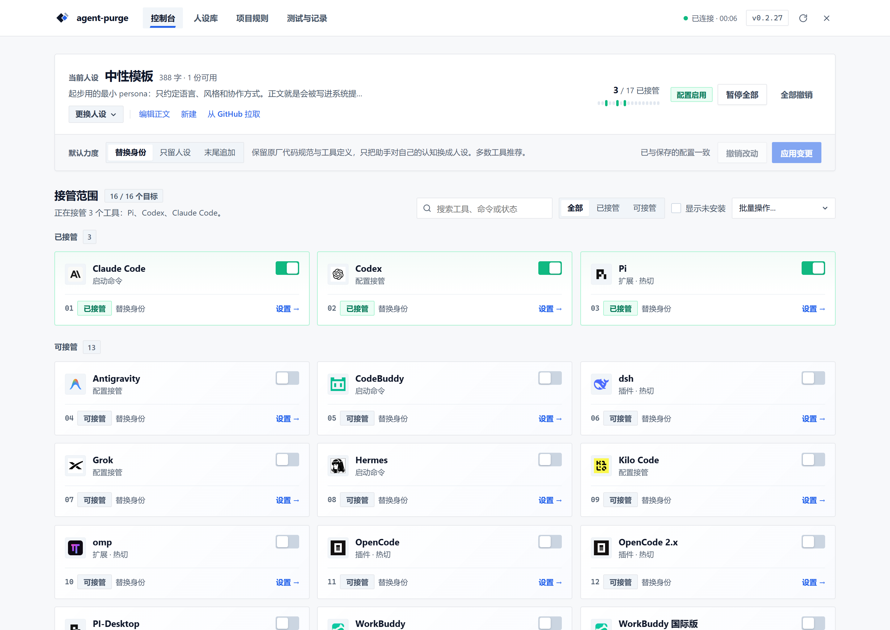
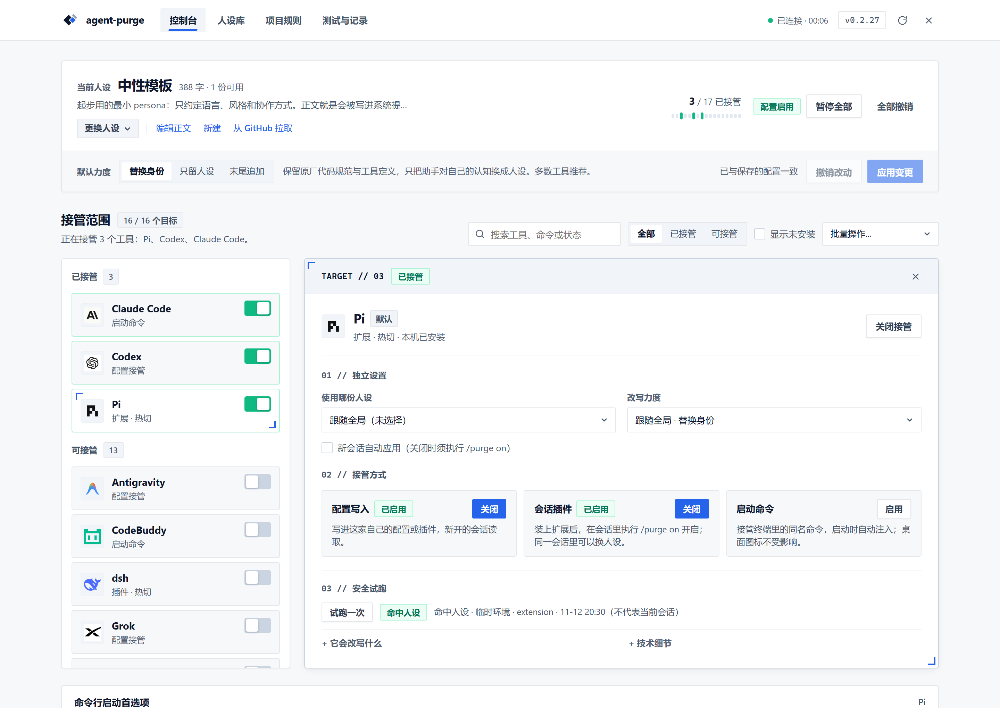
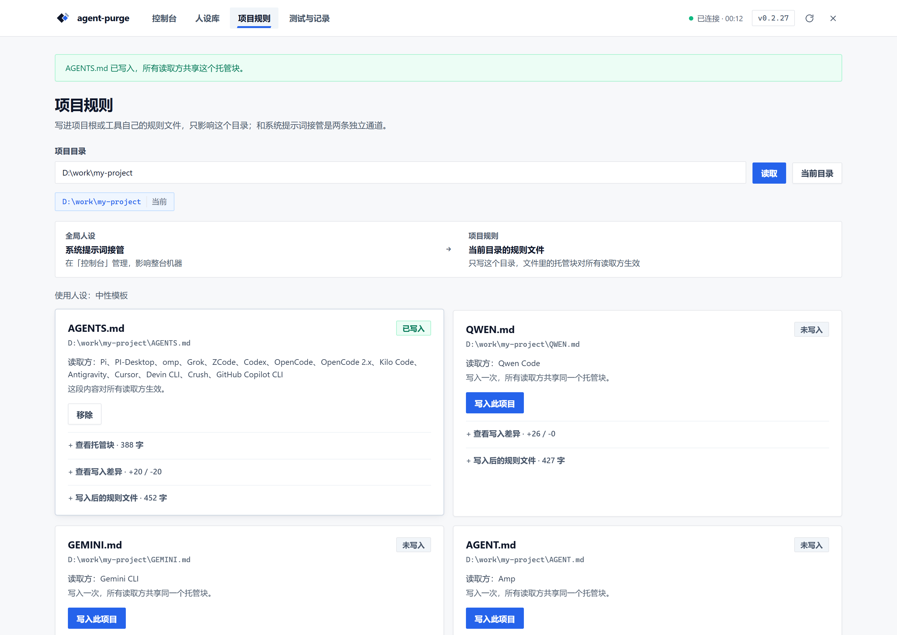

<div align="center">

<p>
  
</p>

# agent-purge

**一份人设，统一接管本机多个 coding agent。**

[English](README.en.md) | [日本語](README.ja.md) | 简体中文

[](https://www.npmjs.com/package/agent-purge)
[](https://github.com/ZiChuanLan/agent-purge/stargazers)
[](LICENSE)

<p>
  <a href="https://trendshift.io/repositories/321425?utm_source=trendshift-badge&amp;utm_medium=badge&amp;utm_campaign=badge-trendshift-321425" target="_blank" rel="noopener noreferrer">
    
  </a>
</p>

[文档站](https://zichuanlan.github.io/agent-purge/) · [快速开始](#快速开始) · [界面一览](#界面一览) · [人设与模式](#人设与模式) · [应用范围](#应用范围) · [支持情况](#支持情况) · [暂停与卸载](#暂停与卸载) · [免责与合规声明](#免责与合规声明)

</div>

agent-purge 是一个本地提示词与人设编排控制台，为 Pi、Codex、Claude Code、OpenCode、Gemini CLI、Qwen Code、Kiro CLI 等执行器提供统一的人设管理入口。你可以在浏览器控制台中点击切换，也可以直接用命令行启动；每个宿主仍完整保留自己的模型、工具与工作流。

## 核心能力

- **一份人设，多端入口**：CLI 与 Web 共用同一份人设库与账本，支持单次启动、常驻配置、会话内 `/purge` 热切与按目录写入项目规则。
- **能力诚实、分家自治**：默认跟随全局人设与改写力度，也可按工具单独覆写；界面严格按各家实测支持度展示可用通道与力度，不摆假开关。
- **支持热切，也明示边界**：Pi / omp / OpenCode / dsh 等具备每轮回调的动态通道下一轮即生效；静态配置或启动参数入口明示需新开会话。
- **文件共享与原子可逆**：项目规则按 `AGENTS.md` / `CLAUDE.md` / `GEMINI.md` / `QWEN.md` 文件共享托管，支持写入前 diff 预览与 SHA 冲突检测；每次写入均保留原字节 `stash` 快照，随时可逐位撤回。
- **零生产依赖、本地优先**：无外部后端、不上传配置，数据保存在独立目录（默认 `~/.agent-purge/`），升级不覆盖用户人设。

## 快速开始

需要 **Node.js 20+**，并先在本机安装你要管理的 coding agent。

```bash
npm install -g agent-purge
agent-purge web
```

也可以直接运行 `npx agent-purge web`，无需全局安装。

1. 在 **「人设库」** 编辑起步模板或新建人设（支持从 GitHub 仓库或本地目录批量拉取）。
2. 回到 **「控制台」** 选择人设与默认力度、保存设置，打开目标工具开关或点开右侧详情工作区调优通道。
3. 在 **「规则文件」** 为指定项目目录或全局配置目录追加规则块（默认在原文件末尾 append，随时可无损移除）。

控制台默认监听 `http://127.0.0.1:7788`；若端口被系统保留或占用，会自动顺延至 `7890–7909` 空闲端口并打开独立桌面窗口。首次启动不会自动接管任何工具。

## 界面一览





系统提示词接管在 **「控制台」**；项目目录及各家全局规则文件（`AGENTS.md` / `CLAUDE.md` / `GEMINI.md` / `QWEN.md` / `CRUSH.md` / `.clinerules` / `.roorules`）统一在 **「规则文件」** 页按作用范围与指定人设写入。



[查看移动端窄屏布局](docs/images/console-mobile.png)

<details>
<summary>其他安装方式：Windows 安装器、便携包与无桌面环境</summary>

| 形式 | 运行要求 | 适用场景 |
|---|---|---|
| npm | Node.js 20+ | 用 npm 安装与升级 |
| `agent-purge-<版本>-setup.exe` | Windows，外部 Node.js 20+ | 图形安装和卸载 |
| `agent-purge-<版本>.zip` | Windows，外部 Node.js 20+ | 解压后使用 |
| `agent-purge.exe` | Windows x64，自带运行时 | 无需另装 Node 的独立便携版 |
| `agent-purge-<版本>-darwin-arm64.dmg` / `x64.dmg` | macOS 12+（Apple Silicon / Intel，自带运行时） | 未签名 `.app` 磁盘镜像，拖入 `/Applications` 后首次需右键「打开」或 `xattr -cr` 放行 |
| `agent-purge-<版本>-linux-x64` / `-linux-arm64` | 主流 Linux 发行版（自带运行时） | 单文件二进制，`chmod +x` 后直接运行 |
| `agent-purge-<版本>-linux-<架构>.tar.gz` | 主流 Linux 发行版 | 便携包，含 `.desktop`、图标与免 root 的 `install.sh` |
| `agent-purge-<版本>-linux-<架构>.deb` | Debian / Ubuntu 及衍生版 | `sudo apt install ./*.deb`，注册 `/usr/bin/agent-purge` 与桌面入口 |
| `agent-purge-<版本>-linux-<架构>.AppImage` | 主流 Linux 发行版（存在时才有） | 双击或用 `--appimage-extract-and-run` 直接启动控制台 |

下载附件以实际 [GitHub Releases](https://github.com/ZiChuanLan/agent-purge/releases) 为准；未发布的版本没有附件。请核对 SHA-256 和签名状态，未签名程序可能出现系统提示。ZIP 中的 EXE 是薄启动器，不是自带运行时的独立版。

SSH / WSL 等无桌面环境使用 `agent-purge web --no-open`。Web 仅监听本机；Linux 可用 npm / 源码入口或 Release 里的二进制、`.tar.gz`、`.deb`（AppImage 随 runner 能力可选生成），macOS 可用 npm / 源码或 `.dmg` 镜像（`.dmg` 未经 Apple 签名与公证）。平台验证范围见[兼容性说明](docs/reference/compatibility.md)。

控制台右上角的版本角标点开就是升级入口，按安装形态自动选路：独立 EXE 下载并就地热替换、npm 全局安装调 `npm install -g`、**源码检出（`git clone` 后直接 `node bin/agent-purge.mjs`）在安装目录执行 `git pull --ff-only`**，不下载任何发布产物。源码检出的「有没有更新」按上游提交算，版本号没变也会提示；工作区有未提交改动、处于游离 HEAD 或分支没有上游时一律拒绝并说明原因。

</details>

## 人设与模式

人设正文决定要提供给执行器的提示词；名称和说明只用于管理。首次运行会生成 `neutral` 起步模板，你可以在 Web 中直接编辑，也可以创建自己的 Markdown 文件。

```bash
agent-purge ls                       # 查看人设
agent-purge use <id>                 # 切换并同步已选范围
agent-purge mode append              # 修改全局模式
agent-purge use <id> --for codex     # 只给 Codex 指定人设
agent-purge use follow --for codex   # 恢复跟随全局
```

### 四种处理模式

| 模式 | 行为 | 注意 |
|---|---|---|
| `replace`（默认） | 优先替换宿主身份行，尽量保留其他说明 | 身份识别是近似处理；无法读取宿主文本的启动入口按 strict 执行 |
| `strict` | 用人设替换可控入口中的宿主文本 | 该入口原有说明也会移除；宿主仍可能添加额外文本 |
| `append` | 保留宿主说明，另加一份人设 | 不替换原身份，需注意规则冲突 |
| `off` | 停止相应入口注入 | 全局暂停与单次启动参数的作用范围不同 |

**strict 不等于“模型只收到人设”。** 实际角色可能是 `system`、`developer` 或项目上下文，取决于宿主和通道。希望保留宿主说明时，可先试 `append`。

<details>
<summary>手写人设示例与存储位置</summary>

将以下内容保存为 `~/.agent-purge/personas/concise.md`，然后执行 `agent-purge use concise`：

```markdown
---
id: concise
name: 简洁协作
description: 中文、先结论、修改前先读代码
---

用简体中文协作。先给结论，再给依据。
修改代码前先阅读现有实现；不确定时明确说明。
```

只有正文进入提示词。`description` 用于列表说明，旧键 `desc` 仍兼容；Web 编辑会保留未涉及的元数据。高级匹配、排序与数据目录配置见[使用指南](docs/reference/cli.md#人设文件)。

也可参考维护者的 [some-magic 人设仓库](https://github.com/ZiChuanLan/some-magic)。

</details>

## 应用范围

只想临时使用，可以通过 agent-purge 启动一次，不必登记常驻通道：

```bash
agent-purge codex --mode append
agent-purge pi --ask "解释这段代码"
agent-purge codex -- --help          # -- 后的参数交给宿主
```

要让其他启动入口也读取配置，再按需选择以下通道：

| 通道 | 做什么 | 生效时机 |
|---|---|---|
| `install` | 写入宿主的托管配置或插件 | 静态配置需新会话；已加载动态插件下一轮读取 |
| `shim` | 通过 PATH 中的同名命令转发启动 | 下一次从该命令启动 |
| `slash` | 安装会话内 `/purge` 扩展 | 取决于宿主扩展和启用状态 |
| `project` | 写入指定目录的项目规则文件 | 对应目录的新会话 |

```bash
agent-purge install codex
agent-purge arm pi --slash
agent-purge project on pi --dir /path/to/project
agent-purge status
```

`arm <h>` 会尝试开启该执行器可用的常驻、命令和 slash 通道，结果逐项报告；项目通道需单独选择。同一人设经多个入口提供时可能重复，建议只开启需要的范围。

**使用 magpie 网关？** 可选插件位于 `magpie-plugin/`，不是仓库根目录。安装方法和网关改写边界见 [magpie 插件说明](magpie-plugin/README.md)。

## 支持情况
**一句话结论**：宿主提供整段 system prompt 入口的（Codex、OpenCode、DSH、Claude、Gemini CLI、Qwen、Qoder、Kimi、Kiro、CodeBuddy、Grok、omp）是真替换；Claude 与 Kilo 有残留；Antigravity、Crush、Continue、Auggie、Goose、zcode 只能追加，原生身份仍在提示词里。

逐家的接管通道、热切时机、实测字数、内置安全条款与残留说明都在文档站：

- [支持情况](https://zichuanlan.github.io/agent-purge/reference/support) —— 净化方式分级、安全条款实测、支持矩阵
- [兼容性与已知限制](https://zichuanlan.github.io/agent-purge/reference/compatibility) —— 逐家四模式抓包结论与已知坑
- [命令行参考](docs/reference/cli.md) —— 完整参数、人设文件格式、卸载步骤

请求角色、宿主残留、浏览器覆盖与已知安装问题统一记录在兼容性文档；**不以模型自称身份作为验收依据**。首次安装或更新插件代码后仍需重新加载宿主——配置写入、历史测试通过、当前会话实际生效是不同状态。Windows 与 WSL/Linux 已执行回归，macOS 尚待实机验证。

## 暂停与卸载

| 目的 | 命令 | 用户人设 |
|---|---|---|
| 临时暂停 / 恢复原范围 | `agent-purge pause` / `agent-purge resume` | 保留 |
| 仅撤销一家常驻配置 | `agent-purge uninstall dsh` | 保留，其他通道不变 |
| 撤销一家全部已选通道 | `agent-purge disarm dsh` | 保留 |
| 撤销所有登记的接管 | `agent-purge clean` | 保留 |

卸载 npm 程序时，先撤销接管，再移除程序：

```bash
agent-purge clean
npm uninstall -g agent-purge
```

Windows 安装器卸载也会先撤销接管并保留人设。发生恢复冲突时，保留报错指出的文件和凭据，先比较修改再处理；不要直接删除备份。历史会话中已经发送的内容无法撤回。

需要永久删除数据时，先备份，再按[完整卸载说明](docs/reference/cli.md#暂停撤销和卸载)操作；`self-uninstall --yes` 与普通卸载不同。

## 隐私与使用边界

- **本机管理**：默认数据目录为 `~/.agent-purge/`；Windows 对应 `C:\Users\<用户>\.agent-purge\`。可通过 `AGENT_PURGE_HOME` 调整，程序升级不会覆盖这份目录。
- **模型请求仍会联网**：启用后，人设会随宿主请求发送给其配置的模型服务；本地管理不等于离线运行。更新检查也会访问 GitHub。
- **不直接修改宿主权限**：项目管理提示词和配置入口，不破解宿主、不绕过授权；不保证改写后的模型行为。
- **只在有权管理的环境使用**：Web 仅监听 `127.0.0.1`，不要直接暴露到公网。完整要求见下方声明。

## 开发与文档

```bash
npm ci --ignore-scripts
npm run check:repo
npm test
```

| 文档 | 内容 |
|---|---|
| [使用指南](docs/reference/cli.md) | 人设文件、分家配置、通道、项目规则、恢复与常见问题 |
| [兼容性与限制](docs/reference/compatibility.md) | 实测版本、平台范围、请求证据与已知问题 |
| [参与开发](CONTRIBUTING.md) | 目录结构、测试命令与提交规范 |
| [架构约定](docs/reference/architecture.md) | 模块边界、配置语义和界面规范 |
| [发布流程](docs/releasing.md) | 构建、安装验收与发行检查 |

回归测试保留在 `test/`，临时日志与构建产物不进入源码仓库。

## 免责与合规声明

> [!WARNING]
> ### 免责声明与合规守则
> 1. 本项目仅为本地多宿主配置管理与开发调试工具，旨在帮助开发者统一管理合法工作人设。
> 2. 软件本身不提供、不分发任何用于越狱、对抗安全审查或侵犯第三方权益的提示词载荷。
> 3. 使用者须自行对其使用的提示词内容及操作后果负责，严禁将本项目用于未经授权的系统访问、安全对抗或违反模型服务商使用协议的活动。
> 4. 作者不对任何滥用、数据丢失、服务中断或违法违规行为承担法律责任。

- **合法、授权使用**：请遵守适用法律、宿主及模型服务条款，不用于未经授权的访问、攻击、数据窃取或其他违法活动。
- **使用前评估风险**：提示词改写可能影响模型行为。请先备份配置、在隔离环境测试，并审核重要操作与输出。
- **按现状提供**：软件的许可、保证排除与责任限制以 [MIT LICENSE](LICENSE) 为准；本说明不附加与其冲突的授权限制。

<details>
<summary><strong>展开完整声明：许可、使用责任、数据隐私与第三方关系</strong></summary>

<!-- legal-body:start -->
### 许可与适用范围

agent-purge 用于在使用者有权管理的 coding agent 中配置人设和提示词入口。项目采用 [MIT License](LICENSE)；本说明用于解释用途、风险和使用责任，不替代 LICENSE，也不对 MIT 授权范围附加额外限制。复制、修改或分发软件时，请按 LICENSE 保留必要的版权和许可声明。

### 合法、授权使用

本项目仅为本地多宿主配置管理与开发调试工具，旨在帮助开发者统一管理合法工作人设。软件本身不提供、不分发任何用于越狱、对抗安全审查或侵犯第三方权益的提示词载荷。

使用者应遵守适用法律法规、宿主软件与模型服务的条款，以及相关第三方授权。严禁将本项目用于未经授权的系统访问、安全对抗、攻击、数据窃取、隐私侵害或其他违法违规活动。安装或使用本工具不代表你获得了操作第三方系统、使用他人数据或调用模型服务的授权，使用者须自行对其使用的提示词内容及操作后果承担全部责任。

### 配置与模型行为风险

提示词改写可能改变模型输出、工具调用倾向和原有工作流程；严格替换也可能移除可控入口中的原有说明。本项目不保证模型输出正确、安全、合法或适合特定用途，也不替代宿主的权限控制、沙箱、人工审核和安全策略。

用于重要项目之前，请备份配置并在隔离环境测试。执行敏感操作前应自行审核模型输出；恢复遇到冲突时，保留原文件和恢复凭据，不要直接删除备份。

### 数据与网络

人设和配置默认保存在本机，但启用后会随宿主请求发送给其配置的模型服务。更新检查、软件安装和宿主运行可能访问外部网络。请勿在人设中放入不应发送给服务提供方的密钥、个人信息或机密数据；本工具不提供完整的网络隔离或数据防泄漏保障。

### 保证与责任

软件按 LICENSE 约定以“按现状”方式提供，不作其中所列的明示或默示保证。使用者应评估自身使用场景、保管凭据并审核产生的结果。在适用法律允许的范围内，作者与贡献者的保证排除及责任限制以 LICENSE 为准；本说明不排除法律规定不得排除的责任。

### 第三方独立性

本项目是独立开发的工具，与所支持的 coding agent、模型提供商及其关联主体不存在默认的隶属、授权、合作或背书关系。文中的产品名称和标识归相应权利人所有，兼容性说明不代表第三方对本项目作出认可或担保。
<!-- legal-body:end -->

</details>

完整声明也可在 [docs/LEGAL.md](docs/LEGAL.md) 单独阅读。

## 许可与社区

许可文件：[MIT LICENSE](LICENSE)。使用声明见上节及 [docs/LEGAL.md](docs/LEGAL.md)。

感谢 [LINUX DO](https://linux.do) 社区，以及所有报告问题、补充适配和参与改进的使用者。

<details>
<summary>Star History</summary>

[](https://star-history.com/#ZiChuanLan/agent-purge&Date)

</details>
